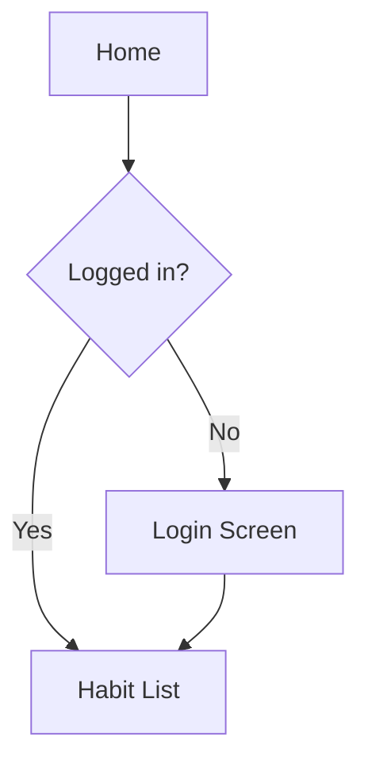

# Discovery

## When to Use

**Invocation.** The user names this skill, for example:
- "start discovery for X"
- "let's do product discovery"
- "is X worth building"
- "define the MVP for X"
- "I have an idea for X"

**Explicit use only** — discovery is always an intentional act, never started without the user naming it.

**Entry point detection** — Claude checks `~/Developer/docs/plans/<project-name>/` (or the plans directory the global CLAUDE.md names) for existing artifacts before starting:

| Existing artifacts | Entry point |
|---|---|
| None | Phase 0: Viability |
| `viability.md` exists | Phase 1: One-Pager |
| `viability.md` + (`one-pager.md` OR `lean-canvas.md`) exist, and `job-stories.md` does not | Phase 2: Job Stories |
| `viability.md` + (`one-pager.md` OR `lean-canvas.md`) + `job-stories.md` exist | Phase 3: User Flows |
| All four artifacts exist | Summarize current state, ask what to revisit |

**"Summarize current state" format:** One-line verdict from `viability.md`, MVP scope from one-pager/lean-canvas, story count by group (Onboarding / Core Loop / Edge Cases), flat list of screens from the inventory.

If the project folder does not exist, create it at `~/Developer/docs/plans/<project-name>/` (or the plans directory the global CLAUDE.md names) before Phase 0 begins. Project name is derived from the idea name, kebab-cased (e.g., "Habit Tracker" → `habit-tracker/`).

**Not this skill:**
- Implementing a feature (use `dev`)
- Reviewing architecture of an existing project (use `arch-review`)
- Mid-project scope change (start at the relevant phase directly)

## Principles

### Phase 0: Viability

**Purpose:** "Is this worth building?" gate. Produces `viability.md`.

**Research (runs in parallel before conversation):**
Claude researches three areas simultaneously before asking any questions:
- **Technical feasibility** — known limitations of KMP/Go stack for this use case, existing libraries/solutions, build complexity signals
- **Competitive landscape** — does this already exist, what do existing solutions do well/poorly, what gap remains
- **User/market signal** — evidence of real demand (community discussions, app store reviews, existing workarounds)

Research findings are presented as 2-3 bullets per area — no essays.

**Three cost lenses (evaluated in order):**
1. **Development cost** — estimated build complexity, known technical blockers, stack fit, rough time-to-MVP
2. **Operating cost** — hosting, third-party services/APIs needed, estimated monthly cost at small scale (<500 users) and meaningful scale (~10k users)
3. **Opportunity cost** — what else could this time go toward, is there a simpler version capturing 80% of the value

**Conversation flow:**
1. Present research findings
2. Ask one question at a time to fill gaps Claude couldn't research
3. Run `devils-advocate` light mode on the go/no-go decision (a go/no-go call — always, no exceptions)
4. State verdict: **Go** / **Go with constraints** / **No-go**

**`viability.md` template:**
```markdown
# Viability: <Project Name>
**Verdict:** Go | Go with constraints | No-go
**Date:** YYYY-MM-DD

## Development Cost
[1-3 sentences: complexity estimate, blockers, time-to-MVP]

## Operating Cost
[1-3 sentences: services needed, cost estimates at small and meaningful scale]

## Opportunity Cost
[1-3 sentences: trade-offs, simpler alternatives considered]

## Research Findings
### Technical Feasibility
- [bullet]
### Competitive Landscape
- [bullet]
### User/Market Signal
- [bullet]

## Constraints
[Only present if verdict is "Go with constraints" — specific scope limits. Omit this section header entirely for "Go" or "No-go" verdicts.]

## Devil's Advocate Summary
[2-3 sentences: what the challenger found, how it affected the verdict]
```

---

### Phase 1: Lean One-Pager

**Purpose:** Structure the committed idea. Produces `one-pager.md` or `lean-canvas.md`.

**Format detection:**
Claude determines project type from the viability conversation or by asking one question:
- **Commercial potential** (intended for external users, possible monetization, market gap identified) → Lean Canvas format → `lean-canvas.md`
- **Personal/passion project** (self-use, hobby, learning, small collaboration) → Lighter format → `one-pager.md`

**Lean Canvas template (`lean-canvas.md`):**

Note: Markdown table limitations prevent the canonical Lean Canvas spatial layout. Labeled sections preserve all nine blocks without implying incorrect spatial relationships.

```markdown
# Lean Canvas: <Project Name>
**Date:** YYYY-MM-DD

## Problem
[Top 3 problems the product solves]

## Customer Segments
[Target users — who has these problems]

## Unique Value Proposition
[Single clear statement: why this, why now, why you]

## Solution
[Top 3 features or capabilities that address the problems]

## Channels
[How to reach customers]

## Revenue Streams
[How money comes in]

## Cost Structure
[Fixed + variable costs]

## Key Metrics
[How to measure success]

## Unfair Advantage
[What can't be easily copied or bought]
```

**Lighter format template (`one-pager.md`):**
```markdown
# One-Pager: <Project Name>
**Date:** YYYY-MM-DD

## Problem
[1-3 sentences]

## Target User
[1-3 sentences]

## Core Value Prop
[1-3 sentences]

## MVP Scope
**In:** [what's included in the first version]
**Out:** [what's explicitly excluded — YAGNI]

## Key Constraints
[technical, time, or resource constraints that shape decisions]
```

Each field is 1-3 sentences maximum. Claude asks 2-3 focused questions together to fill the template, then writes the file. (Phase 1 asks multiple questions at once — unlike other phases which ask one at a time — because the template has few fields and viability context already establishes most answers.)

---

### Phase 2: Job Stories

**Purpose:** Define what users need to do and why. Produces `job-stories.md`.

**Default format (job stories):**
`When [situation], I want to [motivation], so I can [outcome]`

Used by default — focuses on context and behavior rather than role, better suited for personal apps with one primary user type.

**Fallback format (traditional user stories):**
`As a [role], I want [goal] so that [reason]`

Used only when the project has distinct user roles with genuinely different permissions or flows. When used, the file explicitly states: "Traditional format used — this project has [X] distinct roles."

**Story grouping:**
- **Onboarding** — first-time user experience
- **Core loop** — the primary repeated action the app is built around
- **Edge cases** — error states, empty states, offline behavior

**Conversation flow:**
1. Derive an initial set of stories from the one-pager without asking — present the draft
2. Ask one question at a time to validate coverage and surface missing scenarios
3. Write the file when no new scenarios emerge

**`job-stories.md` template:**

When using traditional user stories, change the `**Format:**` line to `**Format:** Traditional user stories (As a / I want / So that)` and add "Traditional format used — this project has [X] distinct roles." below it. Story syntax changes to `As a [role], I want [goal] so that [reason]`.

```markdown
# Job Stories: <Project Name>
**Date:** YYYY-MM-DD
**Format:** Job stories (When / I want to / So I can)

## Onboarding
- When [situation], I want to [motivation], so I can [outcome]

## Core Loop
- When [situation], I want to [motivation], so I can [outcome]

## Edge Cases
- When [situation], I want to [motivation], so I can [outcome]
```

---

### Phase 3: User Flows + Screen Inventory

**Purpose:** Map the paths a user takes and identify every screen needed. Produces `user-flows.md`.

**Adaptive format:**
Claude detects flow complexity and selects format per flow:

**Simple linear path** → numbered text steps:
```
Flow: Mark a habit done
1. User opens app → Habit List screen
2. Taps a habit → Habit Detail screen
3. Taps "Done today" → streak updates, returns to Habit List
```

**Branching or multi-entry flow** → Mermaid diagram:


Mermaid is used only when a flow has branching logic, conditional paths, or multiple entry points. Linear flows always use text.

**Screen inventory:**
Appended at the end of `user-flows.md` — a flat list of every screen with a one-line description and the job stories it serves.

**`user-flows.md` template:**
```markdown
# User Flows: <Project Name>
**Date:** YYYY-MM-DD

## Flows

### <Flow Name>
[Text steps or Mermaid diagram]

### <Flow Name>
[Text steps or Mermaid diagram]

---

## Screen Inventory

| Screen | Description | Serves |
|---|---|---|
| Habit List | Main screen showing all habits and today's status | Core loop stories |
| Habit Detail | One habit with its streak and history | Core loop, edge cases |
```

---

### Integration with Existing Pipeline

| Downstream skill | Input from discovery |
|---|---|
| `devils-advocate` | Light mode runs at Phase 0 go/no-go; also runs in Phases 1–2 if an assumption surfaces that, if wrong, would change the MVP scope or verdict |
| `arch-review` | Constraints from `viability.md` + MVP scope from one-pager inform structure decisions |
| `kmp-go-contract` | Job stories requiring backend calls → contract defined before implementation |
| `dev` | Story groups from `job-stories.md` → OpenSpec changes → GitHub issues |

**Full pipeline:**
```
discovery
  └── viability.md + one-pager.md + job-stories.md + user-flows.md
        └── dev (per story group)
              └── arch-review (how to structure it)
                    └── kmp-go-contract (per backend call)
```

## Constraints

- `devils-advocate` light mode runs at go/no-go — always, no exceptions
- One-pager fields are 1-3 sentences maximum — never exceed this
- Job stories format is default; traditional user stories only for projects with distinct roles and different permission flows
- Mermaid diagrams only for branching/multi-entry flows — linear flows always use numbered text
- Viability (Phase 0) cannot be skipped for new ideas with no existing artifacts
- Format detection for Phase 1 (Lean Canvas vs. one-pager) is determined from viability conversation — ask one question only if unclear

## Examples

### Viability verdict example

Project: Habit Tracker (personal — daily habits with streaks)

```
# Viability: Habit Tracker
**Verdict:** Go with constraints
**Date:** 2026-03-22

## Development Cost
Small scope: a list, a detail screen and a local database. Rough time-to-MVP: 2–3 weekends if kept local-only.

## Operating Cost
No backend for MVP. Cross-device sync adds hosting cost; defer to v2.

## Opportunity Cost
A plain checklist captures most of the value; streaks and reminders are what make it worth building over a notes app.

## Research Findings
### Technical Feasibility
- SQLDelight multiplatform fits a local-first list
- Local notifications need expect/actual per platform
### Competitive Landscape
- Many habit apps exist; the gap must be stated concretely or the verdict is No-go
### User/Market Signal
- Personal use first; no external validation yet

## Constraints
- MVP is local-only: no accounts, no sync
- Reminders deferred until the expect/actual notification wrapper is validated

## Devil's Advocate Summary
The challenger noted the crowded market; the verdict held because the first user is the builder. Build the tracker, use it for a month, then decide on sync.
```

---

### Job stories group example

Project: Habit Tracker — Onboarding group

```
## Onboarding
- When I open the app for the first time, I want to add a habit quickly, so I can see the core experience without setup friction.
- When I add a habit, I want to enter just a name, so I can start tracking without filling out a long form.
- When I add my first habit, I want to see it in my list immediately, so I can confirm the app is working as expected.
```
